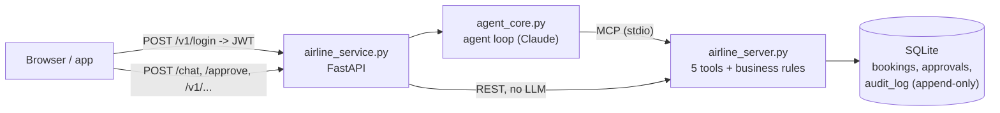

# airline-agent-mcp

An AI support agent for a (fictional) airline, taken from prototype to a production-style service:
an **MCP tool server**, a **FastAPI** service with **JWT auth**, **human-in-the-loop approvals**, an **append-only audit log**,
**prompt-injection defences**, an **eval harness** for the agent's behaviour and a **pytest** suite for the code.



## What it does, with measured results

| Feature | How | Result |
|---|---|---|
| Tools over MCP | `search_flights`, `get_booking`, `change_seat`, `cancel_booking`, `confirm_cancel` | Works from Cursor and from our own agent |
| Identity never comes from the model | `customer_id` from the JWT; hidden from Claude's tool schema; injected into every call | A prompt-injected model asking for another customer's booking gets "not found" |
| Risky actions need a human | `cancel_booking` only *proposes*; `POST /approve` runs the human-only `confirm_cancel` | Expiring, one-time approvals; nothing held open in memory |
| Auth + brute-force protection | scrypt password hashes, 30-min JWT, 5 attempts / 15 min per username + IP | 16/16 attacks blocked; 100 parallel guesses -> 5 checked, 95 x 429 |
| Concurrency-safe | single atomic `UPDATE ... WHERE seat is free`; exclusive-lock DB setup | 30 parallel grabs of one seat -> 1 winner (a naive version sold it 30 times) |
| Audit log | middleware + agent + human hooks, DB triggers block UPDATE/DELETE | 0.36 ms per row; report flags snooping, brute force and identity tampering |
| Fresh data | before each turn, re-read bookings the model already saw; append a live update if changed | stale-data case 10.3 s -> 6.9 s, $0.028 -> $0.021, guaranteed fresh |
| Agent evals | 17 real-Claude cases graded on tools used, approvals, DB state, answer text | 17/17; includes direct and indirect (tool-result) prompt injection |
| Tests | pytest with a fake Claude, fresh DB per test | 28 tests, ~11 s, $0 |

See [ARCHITECTURE.md](ARCHITECTURE.md) for every design decision (what was chosen, what was rejected, and the real numbers).
The first sections there (builds 1-1b) cover MCP basics from an earlier experiment that isn't part of this repo.

## Run it

```bash
python3 -m venv .venv && source .venv/bin/activate
python3 -m pip install -r requirements-agent.txt
export ANTHROPIC_API_KEY=...                                            # your key, never committed
export JWT_SECRET=$(python3 -c "import secrets; print(secrets.token_hex(32))")
python3 -m uvicorn airline_service:app --port 8000                     # terminal 1: the service
python3 -m streamlit run ui.py                                          # terminal 2: chat UI on :8501
```

Dev test accounts are seeded from `DEV_USERS` in `airline_server.py` (for local development only).

```bash
python3 -m pytest              # code checks: fake Claude, free, ~11 s
python3 agent_eval.py          # behaviour checks: real Claude, ~$0.23 per run
python3 airline_agent.py       # terminal chat, no web service needed
```

## Files

| File | Job |
|---|---|
| `airline_server.py` | Data + business rules: tables, MCP tools, ownership checks |
| `agent_core.py` | The agent loop: Claude <-> tools, identity injection, fresh-data updates, audit rows |
| `airline_service.py` | FastAPI front door: startup, `/chat`, `/approve`, audit middleware |
| `bookings_api.py` | REST endpoints for apps (no LLM) |
| `auth.py`, `passwords.py` | Login, JWT, rate limiting, password hashing |
| `audit.py`, `audit_report.py` | Append-only audit log and a report over it |
| `ui.py` | Streamlit chat UI (an ordinary HTTP client of the service) |
| `agent_eval.py`, `agent_evals.json` | Eval harness and cases; past runs in `eval_results/` |
| `tests/` | pytest suite |
| `*_check.py` | Earlier standalone check scripts (attack tests, rate limit, identity) |
